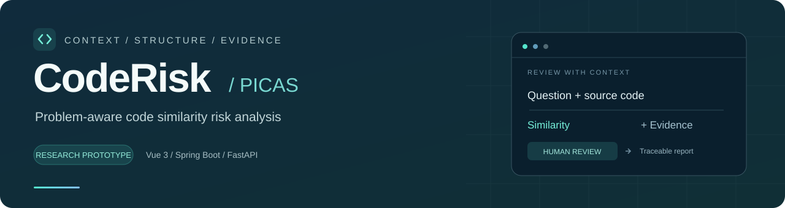
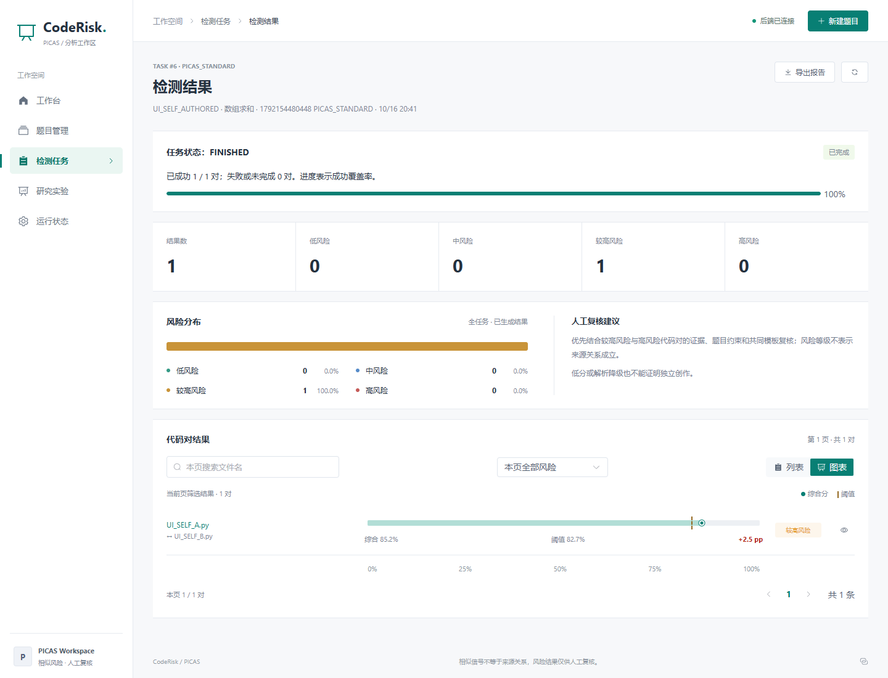
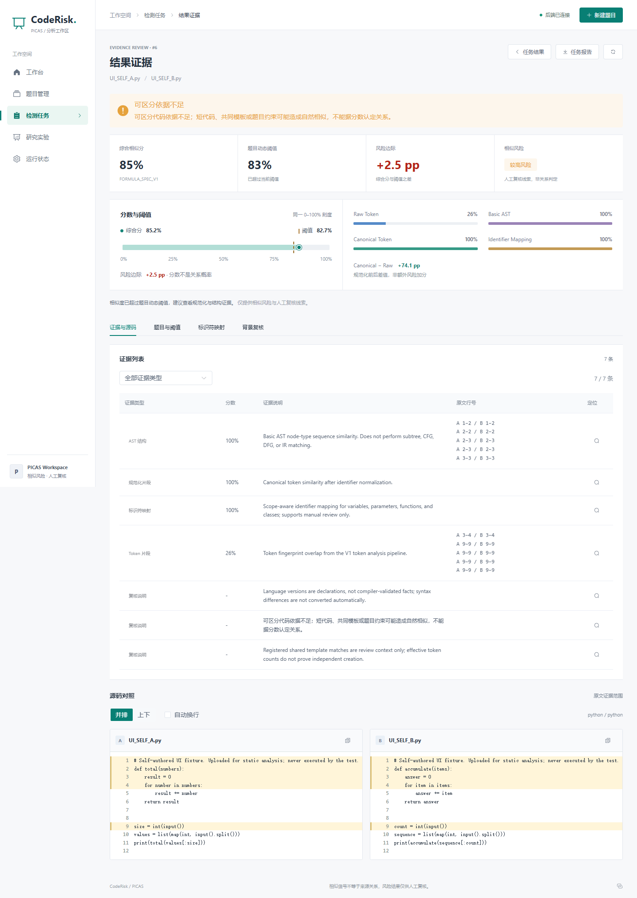
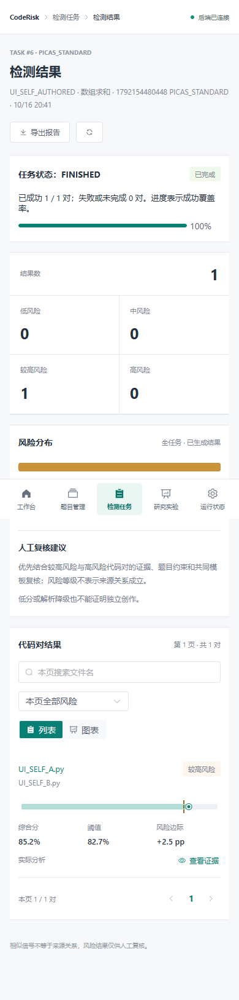
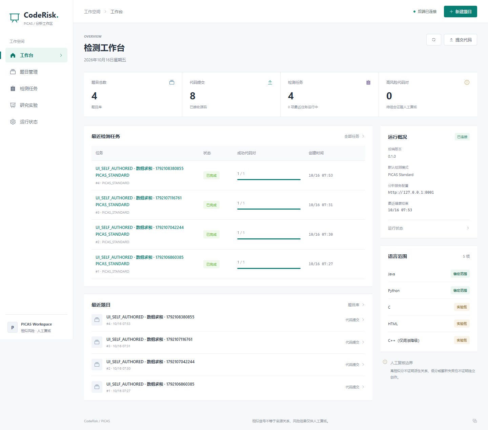
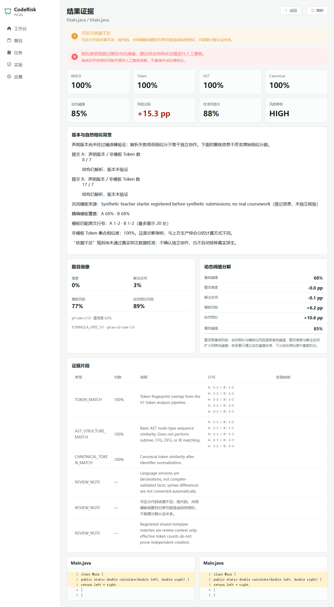
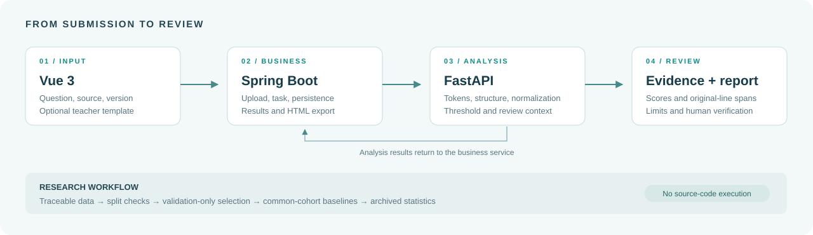
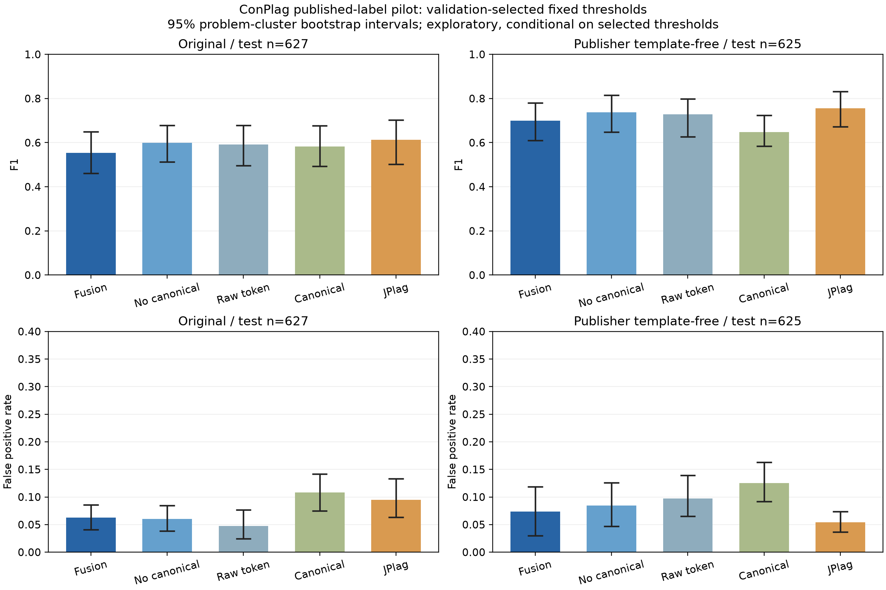

<p align="center">
  
</p>

<h1 align="center">CodeRisk / PICAS</h1>

<p align="center"><strong>面向编程作业的题目感知型代码相似风险检测系统</strong><br>
Problem-aware code similarity risk analysis for programming assignments.</p>

<p align="center"><sub>题目背景 · 稳定表示 · 原文证据 · 人工复核<br>Vue 3 / Spring Boot / FastAPI</sub></p>

<p align="center">
  <a href="#快速启动">快速启动</a> ·
  <a href="#界面预览">界面预览</a> ·
  <a href="#数据规模概览">数据规模</a> ·
  <a href="#实验与数据">实验记录</a> ·
  <a href="#研究复现">研究复现</a> ·
  <a href="coderisk_docs/README.md">文档导航</a> ·
  <a href="LICENSE">MIT License</a> ·
  <a href="https://github.com/weidonglang/CodeRisk-PICAS/actions/workflows/ci.yml">构建检查</a>
</p>

<p align="center">
  <a href="https://github.com/weidonglang/CodeRisk-PICAS/actions/workflows/ci.yml"></a>
  <a href="LICENSE"></a>
</p>

---

## 项目介绍

同一道简单题的解法可能天然相似；教师提供的框架也可能占据大部分代码。仅凭一个相似百分比，很难区分共同题目约束、表层改写与需要进一步核实的派生关系。

**CodeRisk 把题目背景、代码结构和复核证据一起呈现。** 系统结合规则题目画像、动态阈值、作用域标识符规范化与多维相似度，完成“创建题目 → 上传代码 → 执行任务 → 查看证据 → 导出报告”的流程，辅助人工评估相似风险。

PICAS 是本项目的方法名称：**Problem-aware Invariant Code Similarity Analysis**。项目是本科毕设研究原型，保留 Vue + Spring Boot + Python 的业务链路，在隔离实验中检验规范化与题目感知方法。

> 系统输出相似风险与复核线索，不直接认定抄袭。高分不等于关系成立，低分或解析失败也不证明独立创作。

| 工作流程 | 页面提供的信息 | 研究边界 |
| --- | --- | --- |
| **先看任务** | 成功覆盖率、全任务风险分布、逐对分数与阈值对比 | 失败与待处理代码对不计入已生成结果 |
| **再核证据** | Raw / AST / Canonical / Mapping、原文行号、作用域映射、题目背景 | 规范化差值不是额外加分，风险分不是来源概率 |
| **留存报告** | HTML 报告、完整分量、阈值解释与人工复核建议 | Experimental 指标保持生产权重 0 |

## 数据规模概览

截至 **2026-10-11**，本地公开数据接收池已达 **92,513 条代码对／候选登记**，不止早期的一千多对。本次按当前六份 JSONL 清单逐行核对，旧版本/重建目录不重复累计。

<p align="center"><strong>60,000 对 Java / Python</strong> · <strong>30,893 对跨语言候选</strong> · <strong>7 种语言素材</strong></p>

Java 与 Python 各已选 **30,000 对**；跨语言候选通过标题对齐，尚非已确认平行关系。XLCoST 覆盖七语言的 **57,661 条预分词程序记录**，不是原始源码。

另外保留 IR-Plag / ConPlag 的 **1,371 对发布关系**与 AD2022 的 **249 对未标注课程候选**。登记量不等于全球内容去重、可信正负例或已完成检测的实验量；当前公开登记的正式核心指标资格仍为 **0**。

数据构成、七语言数量及已运行实验见[实验与数据](#实验与数据)；逐行统计与文件 SHA-256 见[本次数据核对](coderisk/experiment/evidence/readme-data-refresh-20261011/README.md)。运行和研究状态见[当前进度](#验证与当前进度)。

## 界面预览

**2026-10-16 结果展示增强**：全任务风险分布、列表/图表切换、综合分与阈值同刻度对比、规范化差值、阈值分解和手机结果列表。无需额外图表依赖，保留数值与可访问标签。下图来自真实三服务和隔离 H2 联调；自有 `UI_SELF_AUTHORED` 数据仅验证界面与流程，**不是正式 benchmark 或真实学生案例**。

<p align="center"></p>

快速定位：[图表与结果阅读说明](coderisk_docs/RESULT_PRESENTATION_GUIDE.md) · [一键启动与运行手册](coderisk_docs/FRONTEND_AND_DEV_WORKFLOW.md) · [本轮检查记录](coderisk/experiment/evidence/result-review-20261016/README.md)。

<details>
<summary>证据详情与手机展示</summary>

综合分和阈值共享刻度，Raw/Canonical 差值单独解释；证据可筛选并定位长源码，标识符映射支持搜索，源码支持并排/上下与自动换行。

<p align="center"></p>
<p align="center"></p>

</details>

<details>
<summary>工作台与上一轮界面记录（2026-10-16）</summary>

<p align="center"></p>

[上一轮证据详情](coderisk_docs/assets/ui-evidence-20261016.png)与[上一轮验证记录](coderisk/experiment/evidence/ui-refresh-20261016/README.md)保留，不覆盖历史截图和实验输出。

</details>

<details>
<summary>历史界面与模板联调记录（2026-10-09）</summary>

**真实前端与分析服务的 synthetic 开发示例。** 两份短计算器代码相似分为 100%，页面同时提示“可区分依据不足”，展示语言版本声明、模板覆盖、原文范围与剩余代码量。HIGH 是相似风险等级，不是关系判定。

<p align="center">
  
</p>

截图背景与限制见 [合成联调记录](coderisk/experiment/evidence/review-context-20261009/README.md)。本地可按[快速启动](#快速启动)走完题目、上传、结果、证据和报告流程。

</details>

## 研究问题与方法概览

**2026-10-12 AI 时代价值验证 V0—V5 增量**：新增无网络会话导入、来源/辅助方式/课程政策分离、泄漏门禁、六方法对照及出题前/交卷后只读报告。13 份自编代码、12 个 mock 会话、22 对仅验证管线；本地 JPlag 实跑 19 对匹配，严格共同支持 14 对，正式 FPR/F1 为 N/A。真实跨模型生成、真人标签和教师效益尚未运行，当前结论是 **INSUFFICIENT_EVIDENCE**，建议有条件缩小为方法边界与辅助复核研究，不能称已证明检测增益。见 [价值审计](coderisk_docs/research/AI_ERA_VALUE_AUDIT.md)、[复现手册](coderisk_docs/research/REPRODUCE_AI_CONVERGENCE.md)、[原始证据](coderisk/experiment/evidence/ai-era-value-20261012/README.md) 和 [Go / Pivot / Stop 决策](coderisk_docs/research/PICAS_GO_NO_GO_DECISION.md)。

**2026-10-11 开题 S0—S5 增量**：已补轨道/商集/α-等价边界、独立手标绑定 oracle、Java header 遮蔽降级、双维诊断及真实数据前检。[开题研究包](coderisk_docs/research/OPENING_RESEARCH_PACKAGE.md)提供从零复现、真人采集/复核教程、数学义务与答辩 QA。可自动部分已落地；正式效果仍被授权、双人关系标签和可信参考不足阻断。该日期归档中的“未提交/未推送”是当时状态，不代表当前发布状态。

开题阶段聚焦两个问题：合法标识符重命名下表示能否稳定，以及题目背景与可信独立解答的自然相似分布能否减少不合理误报。已有方法保留 raw Token、基础结构、作用域 canonical Token、标识符映射、规则题目画像与原文证据；具体效果由独立数据验证，不预设 PICAS 全面优于其他工具。

### 群作用与代码不变性

研究目标是有限 Java/Python 子集上 `C(g·P) = C(P)`：g 仅表示固定名称域中合法、捕获规避且保留外部名称的标识符置换，C 是完整规范化 token 序列。首批已修复直接函数关键字实参绑定、动态名称访问回退及 Java 局部声明点，并提供条件证明草图和自动合法变体测试；**不是所有程序上的形式化证明**，不能把算法接受输入的 mode 当作保证证书。

该性质不覆盖删除/插入语句、函数拆分、表达式交换或语句重排，也不属于整个 PICAS 加权分数：raw 分量会随名称改变。规范化表示相同不等于抄袭，也不证明语义等价。固定域的统一拼写置换不等于所有逐绑定 alpha-renaming；完整定义、例外与有限证据见 [群作用与实现边界](coderisk_docs/research/GROUP_ACTION_INVARIANCE.md)、[轨道与 α-等价](coderisk_docs/research/ORBIT_ALPHA_EQUIVALENCE.md) 和 [当前基线审计](coderisk_docs/research/OPENING_BASELINE_AUDIT.md)。

在绑定正确、作用域/声明编号与拼写无关、覆盖正确的条件下，同轨道程序具有相同 C，C 可下降为商集上的特征；**没有证明该特征单射，也不是完整 α-等价判定器**。本轮 12 个自有手标金样例、三个固定 seed 的 1,728 次置换通过，拒绝/解析失败/不确定另列；数量包含重复和未使用名的稳定子，不是 1,728 独立程序。还实测了“完整 C 不同而 n-gram/融合分相同”的重复语句反例。[证明义务](coderisk_docs/research/GROUP_ACTION_PROOF_OBLIGATIONS.md) 与 [双维诊断](coderisk_docs/research/INVARIANCE_DISCRIMINABILITY_REPORT.md) 保留限制及负结果。

### 为什么不直接使用 AI

LLM 可能擅长理解复杂结构与改写，在某些数据上也可能优于规则工具；PICAS 的确定性分量、题目规则与原文定位并不证明其效果更好。两者在批量成本、版本稳定性、学生代码隐私与证据核查方面有不同权衡。

现在已提供[离线 Direct LLM 对照](coderisk_docs/research/LLM_BASELINE.md)：相同背景、独立提示词、严格 JSON Schema、缓存、预算和 validation-only 选参；**真实模型尚未运行**。可选[混合原型](coderisk_docs/research/HYBRID_DETECTION.md)先核验候选 Recall@K，再要求可靠真实基线与人工批准。默认 mock/dry-run 不调用网络、不上传学生代码、不付费，模型线索不能代替人工判断。

### 当前实现、实验性与计划中

| 项目 | 当前状态 |
| --- | --- |
| 作用域标识符规范化 | 有限 Java/Python 实现；历史 288 探针保留，新增独立手标 oracle/1,728 有限置换及明确降级；条件证明，不保证任意合法改名 |
| raw/结构/canonical/映射融合 | 已实现固定权重与分量输出；探索中完整融合并非 F1 最优 |
| 规则题目画像与动态阈值 | 已实现有界规则；降低真实自然相似误报的效果待验证 |
| 表达式交换、语句重排、函数拆分 | 规格设计/后续方向，普通 canonical 未实现，不归入改名群 |
| 跨语言 IR、轻量控制/数据摘要 | limited experimental，生产权重 0，不是完整 CFG/DFG |
| 独立分布统计校准 q_p(s) | 隔离 experimental runner、质量门禁/冷启动已实现；可信参考 0，真实效果未验证，q 不是抄袭概率 |
| Direct LLM baseline | 隔离离线工具已实现：mock/dry-run/授权导入、Schema、缓存、预算、原文证据；真实 LLM 未运行，不能宣称效果 |
| PICAS→LLM→人工混合 | 隔离离线原型/Recall@K 门禁已实现；当前无完整候选池与真实基线，真实混合评测阻断，不接入默认业务 |
| 跨模型趋同与稳定—区分权衡 | 离线导入、connected split、逐对分布/缺失及聚类统计已实现；当前 mock 仅 DEVELOPMENT_ONLY，真实收益不可估计 |
| 出题前预检 / 交卷后上下文 | 只读 JSON/Markdown 原型；不改变生产风险分，无真人效益结果，尚未接入 Vue 默认流程 |

## 研究复现

最新 V0—V5 的 [PowerShell 完整流程](coderisk_docs/research/REPRODUCE_AI_CONVERGENCE.md) 和 [真实采集操作教程](coderisk_docs/research/LIVE_GENERATION_PLAYBOOK.md)复用原 loader、评分与 JPlag 工具。完整最新输出在本地 `output/ai-era-value-20261012/analysis-release/`，精选结果、失败和版本哈希在 [AI 时代证据目录](coderisk/experiment/evidence/ai-era-value-20261012/README.md)。`--formal` 对当前合成集合预期拒绝并退出 2，不把正式资格 0 改成漂亮成绩。

本轮完整状态、文件清单、测试、负结果及导师陈述见 [V0—V5 交付报告](coderisk_docs/research/AI_ERA_FINAL_REPORT_20261012.md)。下一步是许可/可靠数据/真人复核，而不是默认继续添加检测功能。

本轮 S0—S5 的新入口是 `group_action_properties.py` 与 `check_formal_readiness.py`，复用现有消融/校准/只读诊断。全量新输出在 `output/opening-research-20261011/`，精选证据见 [本轮归档](coderisk/experiment/evidence/opening-research-20261011/README.md)；可复制 PowerShell 命令、真实数据的文件/metadata要求见 [总导航](coderisk_docs/research/OPENING_RESEARCH_PACKAGE.md) 和 [采集教程](coderisk_docs/research/REAL_DATA_ACTION_GUIDE.md)。当前前检为 `FORMAL_BLOCKED`，可信独立参考为 0，不把 seed 或 placeholder 提升为正式数据。

所有新增方法都在独立实验入口运行，不悄悄修改生产评分。输出不可覆盖，记录配置、数据/源码 hash、随机种子、版本、Git 状态与时间。**Synthetic、公开单人标签和未标注候选不能冒充正式 benchmark。**

| 阶段 | 运行入口 | 真实状态与记录 |
| --- | --- | --- |
| 1 · 改名不变性 | `identifier_renaming.py` | 288 自有合法置换探针；[定义与边界](coderisk_docs/research/GROUP_ACTION_INVARIANCE.md) |
| 2 · 多维消融 | `similarity_ablation.py` | 14 方法、失败/降级/AP；[归档](coderisk/experiment/evidence/similarity-ablation-20261010/README.md) |
| 3 · 独立分布校准 | `natural_similarity_calibration.py` | 可信参考 0，逐条规则回退；[归档](coderisk/experiment/evidence/natural-calibration-20261010/README.md) |
| 4 · Direct LLM | `llm_baseline.py` | mock/dry-run；JPlag 72 对对齐，LLM N/A；[归档](coderisk/experiment/evidence/llm-baseline-20261010/README.md) |
| 5 · 混合复核 | `hybrid_review.py` | 完整候选池缺失，实跑阻断；[归档](coderisk/experiment/evidence/hybrid-review-20261011/README.md) |

以下命令从仓库根目录执行；先按快速启动安装依赖。本机旧 `.venv` 不可用时，替换 `$Python` 为实际可用的解释器。本轮使用 `./.tmp/language-venv/Scripts/python.exe`，其他机器不应依赖这个本地临时路径。

```powershell
$Python = (Resolve-Path ./coderisk/analysis-service-python/.venv/Scripts/python.exe).Path
& $Python coderisk/experiment/llm_baseline.py --help
& $Python coderisk/experiment/hybrid_review.py --help
& $Python coderisk/experiment/llm_baseline.py --output output/llm-mock-new --allow-development
& $Python coderisk/experiment/hybrid_review.py --output output/hybrid-mock-new --allow-development
# 实跑 JPlag 需要预先准备 Java 和固定版本 jar；无 jar 时不冒充已执行。
& $Python coderisk/experiment/research_v4_jplag.py --output-dir output/jplag-new --execute
& $Python coderisk/experiment/llm_baseline.py --output output/llm-aligned-new --allow-development --jplag-dir output/jplag-new
```

现 seed 的正式评测默认被门禁拒绝；`--allow-development` 只允许流程验证，不能豁免数据许可、伪造真人复核或绕过真实混合基线门禁。离线导入格式与授权要求见[阶段 4 手册](coderisk_docs/research/LLM_BASELINE.md)；完整池、Recall@K、人工队列见[阶段 5 手册](coderisk_docs/research/HYBRID_DETECTION.md)。

<details>
<summary><strong>阶段 1：条件证明、实现修复和真实测试</strong></summary>

2026-10-10 [第一批交付](coderisk_docs/research/FIRST_BATCH_REPORT.md)及[原始证据](coderisk/experiment/evidence/identifier-invariance-20261010/README.md)：修复前 18 项中 14 失败；首批验收时工作树 Python 318 项通过（含此前其他未提交任务测试），新增三文件 55 项通过。288/288 自有变体的 C 一致，576 次逆/复合检查通过，抽取 12 个 Java 变体编译通过；后端 19 项 H2 测试、前端类型检查/构建通过。没有新增 MySQL 实库或浏览器端到端验证，生产公式及 experimental 权重未改。

```powershell
# 根目录；先按下方安装依赖。输出目录必须未存在。
& ./coderisk/analysis-service-python/.venv/Scripts/python.exe -m pytest -q -p no:cacheprovider
& ./coderisk/analysis-service-python/.venv/Scripts/python.exe coderisk/experiment/identifier_renaming.py --help
& ./coderisk/analysis-service-python/.venv/Scripts/python.exe coderisk/experiment/identifier_renaming.py --output output/identifier-invariance-new-run --seed 20261010
# 可选加 --java-compiler "$env:JAVA_HOME/bin/javac.exe"；未提供不会声称已编译。
```

上述 synthetic 是正确性探针，不是检测 benchmark。动态阈值减少真实自然相似误报的效果仍待可信独立数据验证；公开同题不同提交不能自动作为独立负例。Java 绑定仍有启发式限制，Python 动态访问不能穷尽。相似分和风险等级不能作为直接处分学生的依据；统计上尾概率不是抄袭概率，规范化不证明完整语义等价，系统不识别 AI 来源。

</details>

<details>
<summary><strong>阶段 2：多维消融及完整融合的限制</strong></summary>

2026-10-10 [阶段 2：多维消融协议](coderisk_docs/research/SIMILARITY_ABLATION.md)及[真实流程产物](coderisk/experiment/evidence/similarity-ablation-20261010/README.md)已补齐 14 方法配置、validation-only 选参、AP、低 FPR 工作点、逐样本失败/降级和改名分数变化。新测试 19 项、当前工作树全量 Python 337 项通过；本轮不重跑未受影响的后端/前端。

既有 91 对 synthetic 输入中分析 75 对，共同可用 68 对（test 36）。完整融合仍非最高 F1，规则动态阈值降低 FPR 的同时损失召回；这是合成流程观察，不是正式 benchmark 或真实误报改善结论。Recall@K 因缺完整标注 query pool 记 N/A。此阶段未重跑 JPlag；阶段 4 已实跑，两个阶段的共同集合不能直接混比。默认正式模式被质量/注册门禁拒绝。

```powershell
& ./coderisk/analysis-service-python/.venv/Scripts/python.exe coderisk/experiment/similarity_ablation.py --help
& ./coderisk/analysis-service-python/.venv/Scripts/python.exe coderisk/experiment/similarity_ablation.py --output output/research-ablation-new-run --allow-development
```

</details>

<details>
<summary><strong>阶段 3：独立解答上尾概率与冷启动</strong></summary>

2026-10-10 [阶段 3：定义、数据门禁和两种参考协议](coderisk_docs/research/NATURAL_SIMILARITY_CALIBRATION.md)及[真实输出](coderisk/experiment/evidence/natural-calibration-20261010/README.md)：只使用现有生产总分，输出经验上尾与 +1 平滑估计，alpha 仅 validation 选择；缺参考/身份/模板背景、短代码或解析失败均明确回退规则阈值。新测试 40 项通过，生产公式/API/V4 权重未变。

91 对全 synthetic 输入分析 75 对（test 40，含降级）；可信参考 **0**、可计算 q **0**、正式资格 **0**。统计回退与规则结果完全一致，不是统计校准有效的证据。题目隔离的新 test 只能冷启动；预先冻结同题独立面板的协议不能宣称参考/test 题目隔离。ConPlag 的融合负结果继续保留，真实数据独立关系及自然相似误报效果仍待验证。

```powershell
# 本机可用环境；其他机器替换为 README 安装得到的可用 Python。
$Python = (Resolve-Path ./.tmp/language-venv/Scripts/python.exe).Path
& $Python coderisk/experiment/natural_similarity_calibration.py --help
& $Python coderisk/experiment/natural_similarity_calibration.py --output output/natural-calibration-new-run --allow-development
```

</details>

<details>
<summary><strong>阶段 4–5：真实基线结果、已实现工具与阻断项</strong></summary>

阶段 4–5 共新增 54 项测试，隔离源码树独立通过。Direct LLM 实跑 mock/dry-run：91 输入、75 分析、225 计划请求，真实模型响应/新调用/费用均 0。JPlag 6.2.0 Java/Python 实际退出码 0、72 对对齐；下表只取同源码的 **38 对 synthetic test**，不是正式效果结论。

| 方法 | Precision | Recall | F1 | FPR |
| --- | ---: | ---: | ---: | ---: |
| PICAS · validation 选固定阈值 | 0.6667 | 0.9091 | 0.7692 | 0.6250 |
| PICAS · 现行规则动态阈值 | 0.7647 | 0.5909 | 0.6667 | 0.2500 |
| JPlag · validation 选阈值 | 0.7500 | 0.8182 | 0.7826 | 0.3750 |
| Direct LLM / 混合原型 | N/A | N/A | N/A | N/A |

动态阈值在该合成集合降低误报但损失召回，PICAS 并非最优 F1。LLM 不能以 mock 补齐三方结果。现 seed 无完整 query pool，混合实跑为 `BLOCKED_INCOMPLETE_QUERY_POOLS`；真实模型基线也未满足。原文 quote 核对只保证定位，不保证模型推理正确；缓存和本地批准不能证明外部模型调用真实发生。

</details>

## 核心能力

| 能力 | 当前实现 |
| --- | --- |
| **题目感知** | 展示难度、解法空间、模板风险和自然相似风险的规则画像，以及动态阈值的分解过程 |
| **多维比较** | 原始 Token、基础结构序列、规范化 Token 与标识符映射；保留解析或规范化受限的说明 |
| **可复核证据** | 原文行号、代码片段、左右源码比较、变量映射及相似风险解释 |
| **版本与模板背景** | 记录声明的语言版本、共同模板来源与精确匹配范围，展示非模板代码量和依据不足提示 |
| **完整业务流程** | 题目、提交、任务、结果持久化与 HTML 报告导出；本地 H2 或 MySQL 配置 |
| **可复现实验** | 数据来源登记、哈希核查、分集门禁、固定/动态阈值对比、消融、JPlag 基线与图表产物 |

### 语言范围

| 语言 | 当前用途 | 分析范围与边界 |
| --- | --- | --- |
| **Java** | 主实现与主要评测范围 | Token、简化结构序列、作用域规范化；不是完整 Java 编译器或 AST 子树比较 |
| **Python** | 主实现与主要评测范围 | Token、Python AST 节点序列、作用域规范化；受当前 Python 解析器版本限制 |
| **C** | 实验增强 | Tree-sitter 结构与有限作用域规范化；复杂语法可能回退，不编译或运行提交 |
| **HTML** | 实验分支 | 标签、属性、文本及源码结构比较；使用待校准固定阈值，不执行网页或脚本 |

C/HTML 当前仅支持同语言任务。Java/Python 跨语言 IR、控制与数据摘要是实验模块，生产评分权重为零。版本字段是提交者声明，尚未实现完整跨版本语义转换。详见 [多语言范围](coderisk_docs/proposal/MULTILANGUAGE_PROGRESS.md) 与 [版本及自然相似说明](coderisk_docs/proposal/VERSION_AND_NATURAL_SIMILARITY.md)。

## 工作流程与架构

<p align="center">
  
</p>

| 层次 | 技术与职责 | 源码 |
| --- | --- | --- |
| 界面 | Vue 3 · TypeScript · Element Plus · Vite | [frontend-vue](coderisk/frontend-vue) |
| 业务 | Java 21 · Spring Boot · JDBC · Flyway | [backend-springboot](coderisk/backend-springboot) |
| 分析 | Python 3.11+ · FastAPI · Pydantic · Tree-sitter | [analysis-service-python](coderisk/analysis-service-python) |
| 数据 | H2 本地数据库 / MySQL 8 配置、上传目录与证据快照 | [database](coderisk/database/README.md) |
| 研究 | 数据校验、公平评测、JPlag 适配、结果归档与绘图 | [experiment](coderisk/experiment) |

## 快速启动

**2026-10-16：**已增加一键启动与安全停止，旧的手动步骤保留。安装好下方依赖后，在根目录执行：

```powershell
.\coderisk\scripts\start-dev.ps1 -CheckOnly
.\coderisk\scripts\start-dev.ps1
# 停止本次托管服务，保留数据与日志
.\coderisk\scripts\stop-dev.ps1
```

默认H2 local；先等待分析和后端，再启动前端。自动选择可用端口，实际地址与日志位置会打印在终端；可用 `-Python`、`-JavaHome`、`-DataRoot`明确选择环境及隔离数据。详见 [界面与启动流程](coderisk_docs/FRONTEND_AND_DEV_WORKFLOW.md)。MySQL仍需有效凭据，不因一键启动而视为已验证。

准备 **Python 3.11+、JDK 21、Maven 3.9+、Node.js 22 与 npm**。以下命令使用 PowerShell，从仓库根目录运行。

### 1. 获取代码并安装依赖

```powershell
git clone https://github.com/weidonglang/CodeRisk-PICAS.git
cd CodeRisk-PICAS

python -m venv coderisk/analysis-service-python/.venv
& ./coderisk/analysis-service-python/.venv/Scripts/python.exe -m pip install -e './coderisk/analysis-service-python[dev]'
npm --prefix coderisk/frontend-vue ci
```

如 JDK 21 未在 PATH 中，先设置 `JAVA_HOME` 为本机 JDK 目录。Maven 首次启动会下载后端依赖。

### 2. 分别启动三个服务

在三个 PowerShell 终端中，均进入仓库根目录，再分别执行：

| 终端 | 命令 | 默认地址 |
| --- | --- | --- |
| 分析服务 | `./coderisk/scripts/start-analysis-dev.ps1` | <http://127.0.0.1:8001> |
| 业务后端 | `./coderisk/scripts/start-backend-dev.ps1` | <http://127.0.0.1:8080> |
| 前端 | `./coderisk/scripts/start-frontend-dev.ps1` | <http://127.0.0.1:5173> |

默认采用持久化 H2 本地数据库，启动时自动应用 Flyway 迁移。当前开发演示无需登录。MySQL、环境变量与常见启动问题见 [运行手册](coderisk/README.md)；[`coderisk/.env.example`](coderisk/.env.example) 是配置参考，脚本不会自动读取 `.env`。

### 3. 走一遍演示流程

1. 创建题目，填写题目描述；可选登记教师模板及其来源。
2. 上传至少两份同语言代码；可选声明语言版本。
3. 创建并启动 `PICAS_STANDARD` 检测任务。
4. 查看结果列表，再进入代码对详情，核对相似指标、阈值、片段和复核限制。
5. 导出 HTML 报告。实验看板需先生成本地实验产物，克隆后不会自带运行结果。

## 验证与当前进度

| 当前状态 | 最近已验证内容 · 2026-10-16 | 尚未验证 |
| --- | --- | --- |
| **业务与工程** | Python 591、H2后端19、前端单测18、脚本26及build通过；真实流程41+详情5、图表交互30、模拟状态7项浏览器检查通过 | MySQL实库待凭据；自有UI样例不证明研究效果 |
| **研究阶段 1–3** | 有限改名契约、独立消融、统计校准质量门禁 | 可信独立参考为空，真实误报改善未验证 |
| **研究阶段 4–5** | 离线 LLM 协议、JPlag 实跑对齐、混合候选召回门禁 | 真实 LLM 未运行；缺完整候选池，混合效果 N/A |
| **AI 时代 V0—V5** | 会话导入/来源协议、六方法分布、当前 JPlag 共同14对、只读双工作流 | 仅mock；真实生成/关系/教师效益未验证，正式结论不可估计 |

```powershell
# 仓库根目录
./coderisk/scripts/run-all-tests.ps1
```

截至 **2026-10-12**，新 V0—V5 恢复后全量 **591 passed / 1 warning，61.37s**，相对523基线新增68项离线契约；关机前590通过保留为前一轮。恢复时发现隐私测试依赖pytest临时目录位置，隔离测试根并补一项允许/逃逸契约后通过，生产门禁未修改。本轮 H2 **19 tests**、前端类型检查及构建通过。环境/红测/CLI与隐私失败记录保留；[本轮测试摘要](coderisk_docs/research/TEST_AND_EVIDENCE_SUMMARY.md)区分已运行与NOT_RUN，不将测试数当研究样本数。

历史记录（**2026-10-11**）：S0—S5 全工作树 Python **523 项**通过（含预存 pending 任务，既有 warning 1），较当轮基线 431 新增 **92 项**；`mvn test` **19 项 H2** 测试通过；`npm run build` 类型检查与构建成功。Java 头部遮蔽先复现 2 个失败再最小降级，环境失败与依赖 warning 均保留。该轮重跑了独立性质、14 方法 seed 消融、q 冷启动流程及 ConPlag 只读诊断，没有调生产权重或改历史成绩。具体命令/JUnit/差异见[开题研究包](coderisk_docs/research/OPENING_RESEARCH_PACKAGE.md)。历史阶段 4–5 的54项隔离测试仍是历史记录，不能与新增92重复累计。

2026-10-16两轮UI验证均使用隔离H2和真实分析服务：题目→上传→任务→证据→报告、四种视口和解析降级已覆盖。第二轮增加30项图表/映射/长源码定位检查，见 [最新验证](coderisk/experiment/evidence/result-review-20261016/README.md)；重启持久化和重复启动属于[第一轮记录](coderisk/experiment/evidence/ui-refresh-20261016/README.md)。历史研究结果、失败日志和不利比较继续保留；MySQL实库仍待有效凭据，H2测试不能替代它。

详细记录见 [测试报告](coderisk/TEST_REPORT.md)；持续检查见 [GitHub Actions](https://github.com/weidonglang/CodeRisk-PICAS/actions/workflows/ci.yml)。CI 还验证合成开发数据的评测及图表流程，跳过外部 JPlag。MySQL 实库联调仍待验证。

## 实验与数据

### 已接收的数据池

**接收规模、关系质量、实际运行量是三种口径。** 原始下载留在本地，仓库只保存工具、来源登记、审核与统计证据。下面的总数是各来源当前登记行之和，不声称跨来源内容去重或统计独立。

| 来源 | 当前代码对／候选登记 | 表示与用途 |
| --- | ---: | --- |
| **CodeXGLUE / BigCloneBench** | **30,000** | Java 函数片段；发布克隆标签，开发接收池，本地关系未复核 |
| **PoolC** | **30,000** | Python 原始文本；发布标签未本地复核，许可待澄清，本地隔离 |
| **XLCoST 镜像** | **30,893** | 七语言预分词程序的标题对齐候选，未核对官方平行关系 |
| **ConPlag v3** | **911** | 公开单人关系标签；已做探索评测，非本地双人确认关系 |
| **IR-Plag** | **460** | 发布关系登记，含 10 对已标记争议负例；正式资格为零 |
| **AD2022** | **249** | 未标注课程候选，不自动把同题不同提交当独立负例 |
| **合计** | **92,513** | 公开／候选登记；不是 92,513 对可信 benchmark 样本 |

核对公式：`30,000 + 30,000 + 30,893 + 911 + 460 + 249 = 92,513`。六份当前清单内部 pair_id 均无重复；未据此宣称全球源码内容去重。旧汇总 **92,527** 多计 14 行，本次以实际清单修正，不修改源数据或关系标签。

<details>
<summary><strong>代码素材、上游审计量和七语言分布</strong></summary>

| 来源 | 程序／源码数量 | 不能混淆的口径 |
| --- | ---: | --- |
| CodeXGLUE / BCB | 9,126 条函数记录 | 8,063 个不同文本 hash；30,000 对共享函数，不是 60,000 份独立源码 |
| PoolC | 29,280 份不同 Python 文本 | 1,319 份不能用当前 Python 3 解析器解析，不执行、不静默转换 |
| XLCoST | 57,661 条预分词程序记录 | 不是可直接上传/编译的原始代码；不能强行逆分词成假源码 |
| AD2022 | 1,526 份课程解答 | 课程源码数量，不是整个项目的实验代码对总量 |
| IR-Plag | 467 份 Java 源码 | 453 个不同字节 hash，重复源码不能当独立统计单位 |
| Project CodeNet | 320 份有界接收源码 | 用于完整性/解析覆盖；上游 C 目录有语言混杂，未建关系标签 |
| MDN | 46 份 HTML 示例 | 教学结构覆盖，没有可信关系标签 |

上游已下载并审计 BCB **1,731,860 条关系引用**、PoolC 首分片 **598,736 行**；这不等于当前已选池、也不等于已运行检测。上述代码数与预分词记录数不跨来源相加成“独立源码总量”。

XLCoST 当前程序记录分布：

| C++ | C# | Python | Java | JavaScript | PHP | C |
| ---: | ---: | ---: | ---: | ---: | ---: | ---: |
| 11,198 | 10,735 | 10,622 | 11,028 | 9,951 | 3,553 | 574 |

30,893 对跨语言候选中，**20,713 对不含 Java**。采集七语言不等于生产支持七语言：Java/Python 是主范围，C/HTML 是有限同语言实验分支；Java/Python IR 仍是生产权重 0 的 experimental。

</details>

### 已运行的实验与联调

| 运行记录 | 实际规模 | 结论边界 |
| --- | --- | --- |
| ConPlag 探索评测 | 911 对输入；validation 284 / test 627，两个源码视图不是额外样本 | 公开单人标签，完整融合未取得最高 F1 |
| Research V4 seed | 91 对 synthetic 输入；最新同语言实验分析 75 对 | 流程验证，跨语言、占位和不支持范围分开处理，不是正式 benchmark |
| Direct LLM / JPlag 对齐 | 75 对 PICAS 分析、72 对 JPlag matched、共同 test 38 对 | seed 观察；真实 LLM 没有运行，模型指标 N/A |
| 异步任务性能联调 | 50 份自有 synthetic 提交，枚举 1,225 对 | 本机服务链路测试，不计入公开池或关系 benchmark |

**60,000 对大规模已选数据及 30,893 对候选尚未作为本项目完整效果实验运行。** 当前重点是许可、题目/作者来源、关系复核、分集与适配；不能只把“已下载”改写成“已证明有效”。

2026-10-10 增量来源、固定版本及许可核验：[Java 大规模接收](coderisk_docs/proposal/LARGE_PUBLIC_PAIR_INTAKE.md) · [Python/七语言接收](coderisk_docs/proposal/NONJAVA_PUBLIC_INTAKE.md)。登记数量不是可信正负例数量，更不是全球去重后的 problem-disjoint benchmark；PoolC 待许可澄清，XLCoST 不得强行逆分词成假原始代码。

数据补充、manifest、校验、实验及论文表格流程见 [数据收集指南](coderisk/experiment/datasets/research-v4/DATA_COLLECTION_GUIDE.md)、[完整运行手册](coderisk/experiment/RUN_RESEARCH_V4.md)、[结果解读](coderisk/experiment/RESULT_INTERPRETATION_GUIDE.md) 与 [检查清单](coderisk/experiment/RESEARCH_V4_CHECKLIST.md)。先补可靠来源与授权、关系复核、题目分集；不要只为增加数量造标签。

此前 [Research V4 数据入口与融合诊断](coderisk_docs/proposal/INTAKE_AND_FUSION_DIAGNOSTICS.md) 的 Python 224 项是当时记录；开发 synthetic 探针揭示声明顺序敏感性，未改变生产公式或证明正式检测效果。

历史[新数据、融合诊断与异步任务恢复](coderisk_docs/proposal/NEXT_THREE_PROGRESS.md)验证了 1,225 对的真实服务执行和启动快速返回。这是单独的合成性能联调记录，**不是当前数据池只有 1,225 对**。

随后用三位 AI 子智能体分工检查，修复 Python lambda/类作用域边界、任务重启标记、同题并发画像写入和极大页码；IR-Plag 改为固定来源重建核验，并新增打乱顺序的复核包。工作台区分 HUMAN / AI，AI 一致意见不计作两位真人。详见 [修复、验证与剩余研究条件](coderisk_docs/proposal/AI_REVIEW_HARDENING.md)。

ConPlag 探索运行保存了运行前方案、分集、逐对分数、消融、JPlag 比较与统计图表。**当前完整融合在该次比较中没有取得最高 F1**；这推动后续诊断，不能包装成方法优越性结论。本次也没有验证动态阈值降低简单题误报。

<details>
<summary><strong>查看探索评测图与完整记录</strong></summary>

图表来自实际归档结果，属于指定公开标签、划分与固定阈值方案下的探索分析；包含方法表现与区间，不是四语言总体成绩。



- [探索结果、共同集合与统计限制](coderisk_docs/proposal/CONPLAG_PILOT_RESULTS.md)
- [原始数据获取与许可记录](coderisk_docs/proposal/PUBLIC_DATA_INTAKE.md)
- [多语言接收与解析审计](coderisk_docs/proposal/MULTILANGUAGE_PROGRESS.md)
- [数据复核工作台与防泄漏划分](coderisk_docs/proposal/DATA_REVIEW_WORKBENCH.md)
- [数据标注规范](coderisk_docs/proposal/DATA_PROTOCOL.md) · [公平评测协议](coderisk_docs/proposal/FAIR_EVALUATION.md)

</details>

## 文档与毕设材料

| 阅读目的 | 推荐入口 |
| --- | --- |
| 第一次了解项目 | [项目规格](coderisk_docs/PROJECT_SPEC.md) · [架构说明](coderisk_docs/ARCHITECTURE.md) |
| 本地运行与演示 | [运行手册](coderisk/README.md) · [数据库说明](coderisk/database/README.md) |
| 阅读结果与界面 | [图表/阈值/证据说明](coderisk_docs/RESULT_PRESENTATION_GUIDE.md) · [前端与一键启动](coderisk_docs/FRONTEND_AND_DEV_WORKFLOW.md) |
| 理解评分与算法 | [生产公式](coderisk_docs/FORMULA_SPEC.md) · [算法规格](coderisk_docs/ALGORITHM_SPEC.md) · [规范化说明](coderisk_docs/CANONICALIZATION_SPEC.md) |
| 开题研究第一批 | [精准审计](coderisk_docs/research/IMPLEMENTATION_AUDIT.md) · [有限群作用](coderisk_docs/research/GROUP_ACTION_INVARIANCE.md) · [测试与阻塞](coderisk_docs/research/FIRST_BATCH_REPORT.md) |
| 研究实验增量 | [多维消融](coderisk_docs/research/SIMILARITY_ABLATION.md) · [独立解答统计校准](coderisk_docs/research/NATURAL_SIMILARITY_CALIBRATION.md) · [离线 LLM 对照](coderisk_docs/research/LLM_BASELINE.md) · [混合门禁](coderisk_docs/research/HYBRID_DETECTION.md) |
| 接口与开发 | [API](coderisk_docs/API_SPEC.md) · [表结构](coderisk_docs/DATABASE_SCHEMA.md) · [贡献指南](CONTRIBUTING.md) |
| 开题与后续安排 | [开题材料](coderisk_docs/proposal/README.md) · [毕设计划](coderisk_docs/GRADUATION_NEXT_STEPS.md) |
| 评测与失败案例 | [公平评测](coderisk_docs/proposal/FAIR_EVALUATION.md) · [探索结果](coderisk_docs/proposal/CONPLAG_PILOT_RESULTS.md) |
| AI 时代价值验证 | [来源与会话协议](coderisk_docs/research/AI_CONVERGENCE_PROTOCOL.md) · [上下文边界](coderisk_docs/research/AI_CONTEXT_EXPLANATION_SPEC.md) · [开题补充](coderisk_docs/research/PROPOSAL_AI_ERA_APPENDIX.md) · [本轮测试](coderisk_docs/research/TEST_AND_EVIDENCE_SUMMARY.md) |

当前完成情况与下一步优先级见 [项目与毕设核查](coderisk_docs/GRADUATION_READINESS_REVIEW.md)。全部文档见 [文档导航](coderisk_docs/README.md)。开题材料按当前事实撰写，正式提交仍需学校模板和导师意见。

## 下一步

当前优先只保留三项：①获得授权并冻结 4—8 题的可信来源小试点；②同 cohort 比较 Raw / NoCanon / PICAS / JPlag，公开失败与召回代价；③有同意的教师盲走查，决定上下文卡是否值得保留。下面是历史扩展候选，不表示继续自动扩张算法或调用真实 LLM。

- [ ] 获取可核验的独立解答与自然相似负例，完成双人标注。
- [ ] 在验证集校准版本、模板与短代码复核规则，再冻结独立测试方案。
- [ ] 基于独立数据完成固定/动态阈值、消融和 JPlag 公平比较。
- [ ] 补齐授权 Direct LLM 真实响应、稳定性/费用记录及冻结三方共同评测。
- [ ] 补完整逐候选标注 query pool，先验证候选召回，再获真人批准进行混合实验。
- [ ] 扩展语言版本支持子集与 C/HTML 覆盖，保留失败和回退案例。
- [ ] 完成学校模板对应的开题、论文和答辩材料。

完整路线见 [ROADMAP](coderisk_docs/ROADMAP.md)。完整语义等价判断、完整 CFG/DFG/PDG、AI 生成来源识别尚未实现；已有规范化与题目画像的有效性仍需正式实验支持。[已知问题](coderisk/KNOWN_ISSUES.md)保留具体限制与历史记录。

## 局限与伦理

相似表示、LLM 线索和统计上尾概率都不是“抄袭概率”或关系证明。不能凭风险分处分学生，低分也不能排除派生关系。有限改名不变性不证明完整语义等价；本系统不检测 AI 生成来源。

相同题面与最终代码可以来自不同历史；只接收这些相同观测的分析器无法恢复缺失的来源关系。不同供应商、同题不同提交或功能正确，都不自动证明独立创作。新增 AI 参考上下文仅报告参考集合中的观察及局限，没有可靠数据和真人试验就不能声称降低误报或提高复核效率。

解析/绑定仍有支持范围，受限语法会回退并保留 warning；跨语言 IR/轻量 summary 生产权重始终 0。规则动态阈值的真实自然相似误报收益、统计校准及真实 LLM/混合效果仍待可信独立数据验证。Synthetic seed 只支持流程验证与预实验。

未获许可不上传学生代码；公开数据许可不自动涵盖模型服务上传或再次分发。导入记录、来源、人工复核与成本须可核验，不能把 AI 意见当两位真人标签。历史失败和不利比较保留，不预设 PICAS、JPlag 或 LLM 谁一定更好。

---

## 许可证

本项目原创代码与文档采用 [MIT License](LICENSE)，版权声明为 `Copyright (c) 2026 weidonglang`。

第三方数据、源码样例、依赖与工具仍遵循各自的许可和署名要求，不因本项目采用 MIT 而获得重新许可。未明确授权的数据不自动开放再分发；原始公开数据与下载缓存仍不随仓库提交。

由 [weidonglang](https://github.com/weidonglang) 维护。
